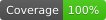

# GitHub Gravity




Make your GitHub contribution graph fall under gravity, colliding with custom text to produce a beautiful animated SVG.

> [中文文档](./README_zh.md)

## Preview



## Live Preview

Try it in the browser: tweak the options, upload a font file or paste a font URL, then play
the animation back.

<https://flycran.github.io/github-gravity/>

## Inspiration

Inspired by [Orta Therox](https://github.com/Orta). Thanks Orta for your outstanding contributions to the open-source community!

## Usage

```yaml
- name: Generate Gravity SVG
  uses: flycran/github-gravity@v1
  with:
    username: flycran
    text: GitHub Gravity
    output-path: gravity.svg
```

### Inputs

| Parameter | Required | Default | Description |
|---|---|---|---|
| `username` | ✅ | - | GitHub username to fetch contributions for |
| `text` | ❌ | `username` value | Text to display as collision obstacles |
| `output-path` | ❌ | `gravity.svg` | Path to write the generated SVG file |
| `font-size` | ❌ | `48` | Font size of the collision text |
| `compression-tolerance` | ❌ | `0.5` | Trajectory compression tolerance in SVG pixels. At every original moment, the animated position stays within this distance of the real one; `0` is lossless in both position and timing (see below) |
| `compression-algorithm` | ❌ | `Greedy` | Trajectory compression algorithm: `Greedy` (fast), `DP` (smallest SVG), `RDP` (fastest). See below for the trade-offs |
| `max-simulation-time` | ❌ | - | Maximum animation playback duration in seconds. Once reached, blocks freeze where they are instead of waiting for every block to settle. Leave empty to play until all blocks rest |
| `shape` | ❌ | `circle` | Shape of contribution blocks: `circle` or `square` |
| `friction` | ❌ | `0.3` | Friction coefficient of the contribution blocks |
| `restitution` | ❌ | `0` | Restitution (bounciness) of the contribution blocks. Values far from 0 may fling blocks out of the visible area |
| `text-top` | ❌ | `50` | Distance from the top of the world to the text |
| `background-color` | ❌ | `transparent` | Background color of the SVG (CSS color value) |
| `text-color` | ❌ | `black` | Color of the collision text (CSS color value) |
| `scale` | ❌ | `3` | Overall zoom applied to the final SVG; does not change the actual size of the physics world |
| `speed` | ❌ | `3` | Playback speed multiplier: the higher the value, the faster the animation plays |
| `css` | ❌ | `false` | Use the CSS animation engine instead of SMIL `animateTransform`. See below |
| `animation` | ❌ | `var(--n) var(--dur) linear both` | Custom CSS `animation` value for the CSS engine. ⚠️ Modify with caution — a wrong value breaks the animation. Requires `css: true` |
| `width` | ❌ | `300` | Width of the physics world. ⚠️ Affects layout and SVG size |
| `height` | ❌ | `150` | Height of the physics world. ⚠️ Affects layout and SVG size |
| `size` | ❌ | `4` | Side length of each contribution block. ⚠️ Affects physics |
| `interval` | ❌ | `1.5` | Spacing between contribution blocks. ⚠️ Affects physics |
| `font-path` | ❌ | bundled font | Custom font file (`.ttf`/`.otf`), relative to the repository root, or an `http(s)` URL. ⚠️ Some fonts may fail to load |

### Reducing file size

The trajectory is compressed by default: `compression-tolerance` merges
trajectory points into keyframes so that, at every original moment, the interpolated
position stays within the given distance (in SVG pixels) of the real one — speed changes
such as bounces, landings and stops keep their real pace.

The default is invisible to the eye and already shrinks the output by orders of magnitude,
so most setups can keep it. Set `0` for a lossless trajectory — only uniform straight
segments and pauses get compressed — or a higher value (e.g. `1.5`) to compress further at
the cost of visibly cutting corners.

### Choosing a compression algorithm

All three algorithms make the same fidelity guarantee; they differ only in how many
keyframes they keep and how long they take. Measured on 360 real trajectories of ~1,000
points each at the default tolerance `0.5`:

| Algorithm | Avg. keyframes | Compression | Runtime | Notes |
|---|---|---|---|---|
| `Greedy` (default) | 32.1 | 30.7x | ~0.2s | Single pass, no backtracking. Within 1–3% of the optimum. |
| `DP` | 31.3 | 31.5x | ~2s | Globally fewest keyframes = smallest SVG. Runtime grows superlinearly with trajectory length. |
| `RDP` | 37.1 | 26.6x | ~40ms | Fastest, keeps the most keyframes. |

In most cases, just keep the default.

### Animation engine

Two output engines are available; both produce a single static SVG file and play the
same trajectory at the same pace:

- **SMIL** (default) drives every block with `<animateTransform>` elements.
- **CSS** (`css: true`) drives every block with a CSS `animation` declaration.

The rendered animation is identical. Choose CSS when the target environment handles
SMIL poorly — some sanitizers strip SMIL animation elements, while CSS animation in
SVG is more widely supported (GitHub READMEs load SVGs via ``, where both work).
The CSS output is slightly larger than SMIL.

With `css: true`, the `animation` input replaces the animation declaration applied to
every block. Available variables:

- `--n` — each block's keyframes name, required
- `--dur` — the playback duration

⚠️ This value is spliced into the generated style block as-is — modify with caution,
a wrong value breaks the animation. Verify in the web preview before committing.
Must not contain braces, semicolons or `]]>`.

### Advanced customization

`width`, `height`, `size` and `interval` change the physics world itself, not just the output
size. The contribution blocks are laid out from `size` and `interval`, the text is centered
with `width`, and the drop height follows `height` — change them together and re-check the
result rather than tweaking one in isolation. If the simulation fails to settle after your
changes, set `max-simulation-time` to cap the animation duration and still get the SVG.

`font-path` swaps the collision font. It accepts a local `.ttf`/`.otf` path or an `http(s)` URL.
The bundled Liberation Serif Bold is used by default because its contours are clean and
decompose stably. Custom fonts are not guaranteed to work:

- Fonts with irregular contours (open or self-intersecting) may decompose into unreliable
  collision shapes.
- Some fonts cannot be parsed by opentype.js at all (common ones such as DejaVu fail on their
  GSUB tables).

### Outputs

| Output | Description |
|---|---|
| `svg-path` | Path to the generated SVG file |

### Full Example

```yaml
name: Generate Contribution Gravity

on:
  workflow_dispatch:
  schedule:
    - cron: '0 0 * * *'
  push:
    branches:
      - main

jobs:
  gravity:
    runs-on: ubuntu-latest
    steps:
      - uses: actions/checkout@v6
      - uses: flycran/github-gravity@v1
        with:
          username: flycran
          text: GitHub Gravity
          output-path: deploy/gravity.svg
      - uses: peaceiris/actions-gh-pages@v4
        with:
          github_token: ${{ secrets.GITHUB_TOKEN }}
          publish_dir: ./deploy
          publish_branch: output
          keep_files: false
          force_orphan: true
```

## Development

### Environment Setup

```bash
bun install
```

### Testing

```bash
npm run test
```

### Bundling

After modifying code under `src/`, re-bundle:

```bash
npm run bundle
```

The Action bundle does not include the browser player; that one is built separately with
`bun run build:web`, which writes static assets to `dist-web/`.

### Local Testing

```bash
npx @github/local-action . src/main.ts .env
```
