# GitHub Gravity


让你的 GitHub 贡献图在重力作用下掉落，与自定义文字碰撞，生成精美的 SVG 动画。

> [English](./README.md)

## 预览



## 在线预览

在浏览器里直接试用：调整参数、上传字体文件或填写字体 URL，然后播放查看效果。

<https://flycran.github.io/github-gravity/>

## 灵感来源

本项目灵感来自 [Orta Therox](https://github.com/Orta) 的创意。感谢 Orta 为开源社区做出的杰出贡献！

## 使用方法

```yaml
- name: Generate Gravity SVG
  uses: flycran/github-gravity@v1
  with:
    username: flycran
    text: GitHub Gravity
    output-path: gravity.svg
```

### 输入参数

| 参数 | 必填 | 默认值 | 说明 |
|---|---|---|---|
| `username` | ✅ | - | GitHub 用户名，用于获取贡献数据 |
| `text` | ❌ | `username` 的值 | 作为碰撞障碍物的文字 |
| `output-path` | ❌ | `gravity.svg` | SVG 输出路径 |
| `font-size` | ❌ | `48` | 碰撞文字大小 |
| `compression-tolerance` | ❌ | `0.5` | 轨迹压缩容差（SVG 像素）。播放时每个原始时刻的动画位置与真实位置的偏差不超过该值（CSS 引擎按轴向各自保证，SMIL 按合成位移保证）；`0` 为完全无损（位置与节奏都精确）（见下文） |
| `compression-algorithm` | ❌ | `Greedy` | 轨迹压缩算法：`Greedy`（快）、`DP`（体积最小）、`RDP`（最快），差异见下文 |
| `max-simulation-time` | ❌ | - | 动画最长播放时长（秒）。到时动画即止，方块停在当前位置，不再等待全部落定；留空则播放至全部静止 |
| `shape` | ❌ | `circle` | 贡献方块的形状（`circle` 或 `square`） |
| `friction` | ❌ | `0.3` | 贡献方块的摩擦系数 |
| `restitution` | ❌ | `0` | 贡献方块的弹性（碰撞恢复系数），远离 0 的值可能把方块弹出画面 |
| `text-top` | ❌ | `50` | 文字距离世界顶部的距离，控制文字垂直位置 |
| `background-color` | ❌ | `transparent` | SVG 背景颜色（CSS 颜色值） |
| `text-color` | ❌ | `black` | 碰撞文字颜色（CSS 颜色值） |
| `scale` | ❌ | `3` | 最终 SVG 的整体缩放，不影响物理世界的实际大小 |
| `speed` | ❌ | `3` | 动画播放倍速，数值越大播放越快 |
| `css` | ❌ | `false` | 启用 CSS 动画引擎替代 SMIL `animateTransform`，见下文 |
| `animation` | ❌ | `var(--n) var(--dur) linear both` | 自定义 CSS `animation` 值（仅 `css: true` 时有效）。⚠️ 谨慎修改，可能破坏动画效果 |
| `width` | ❌ | `300` | 物理世界宽度。⚠️ 会影响布局与 SVG 尺寸 |
| `height` | ❌ | `150` | 物理世界高度。⚠️ 会影响布局与 SVG 尺寸 |
| `size` | ❌ | `4` | 贡献方块边长。⚠️ 会影响物理表现 |
| `interval` | ❌ | `1.5` | 贡献方块间距。⚠️ 会影响物理表现 |
| `font-path` | ❌ | 内置字体 | 自定义字体文件（`.ttf`/`.otf`），相对仓库根目录，也可以直接给 `http(s)` 链接。⚠️ 部分字体可能无法正常加载 |

### 减小文件体积

轨迹默认开启压缩：`compression-tolerance` 会把轨迹点合并为关键帧，保证播放时
每个原始时刻的插值位置与真实位置的偏差（SVG 像素）不超过阈值——碰撞、落地、停顿等
速度变化按真实节奏保留。CSS 引擎按轴独立压缩：阈值按轴向各自生效，几乎不变的轴
（垂直下落的方块横向基本不动）会收缩为静态值，快速自转也不再让位置动画变密；
SMIL 保持共享的位置时间轴，关键帧略多，产物与旧版本逐字节一致。

默认值肉眼不可见，体积已经能小几个数量级，多数场景保留默认即可。设为 `0` 得到无损轨迹——
只有匀速直线段和静止段会被压缩；调大（如 `1.5`）压缩更狠，但轨迹会明显走样。

### 选择压缩算法

三种算法保证相同的保真度，差异只在保留的关键帧数量和耗时。以下为 360 条真实轨迹
（每条约 1000 点）在默认容差 `0.5` 下的实测数据：

| 算法 | 平均关键帧 | 压缩率 | 耗时 | 特点 |
|---|---|---|---|---|
| `Greedy`（默认） | 32.1 | 30.7x | ~0.2s | 单遍贪心不回溯，结果距最优仅 1~3% |
| `DP` | 31.3 | 31.5x | ~2s | 全局最少关键帧 = 体积最小；耗时随轨迹长度超线性增长 |
| `RDP` | 37.1 | 26.6x | ~40ms | 最快，保留的关键帧最多 |

通常保持默认值即可。

### 动画引擎

提供两种输出引擎；两者都输出单个静态 SVG 文件，播放轨迹与节奏完全一致：

- **SMIL**（默认）：每个方块由 `<animateTransform>` 元素驱动。
- **CSS**（`css: true`）：每个方块由一条 CSS `animation` 声明驱动。

渲染出的动画完全一致。当目标环境对 SMIL 支持不佳时选 CSS——部分 sanitizer 会剥除
SMIL 动画元素，而 SVG 内的 CSS 动画支持面更广（GitHub README 以 `` 加载 SVG，
两种引擎都能正常播放）。CSS 产物体积通常更小：它按轴（以及自转）独立压缩，并省掉
从不移动的轴对应的动画。

`css: true` 时，`animation` 输入可替换作用在每个方块上的 animation 声明：每个轴
（x、y 与自转）各复制一份该声明，其中 `var(--n)` 替换为该轴的动画名。可用变量：

- `--n`：各轴关键帧名的占位符，必须包含
- `--dur`：播放时长

⚠️ 该值会原样拼进生成的 style 块，谨慎修改，可能破坏动画效果，修改前先在
web preview 里验证。值中不能包含花括号、分号或 `]]>`。

### 高级自定义

`width`、`height`、`size`、`interval` 改动的是物理世界本身，而不只是输出尺寸。贡献方块按
`size` 和 `interval` 排布，文字以 `width` 居中，下落高度由 `height` 决定——请成套调整并核对
效果，不要只改其中一个。若调整后模拟无法收敛（Action 直接报错），可设置 `max-simulation-time`
限制动画播放时长，仍能正常生成 SVG。

`font-path` 用于替换碰撞字体，可以给本地 `.ttf`/`.otf` 路径，也可以直接给 `http(s)` 链接。
默认使用内置的 Liberation Serif Bold，因为它轮廓规整、分解结果稳定。自定义字体不保证可用：

- 轮廓不规整（未闭合、自相交等）的字体，碰撞体的分解结果可能不可靠、形状异常。
- 部分字体根本无法被 opentype.js 解析（例如很常见的 DejaVu 系列，会因 GSUB 表解析失败）。

### 输出

| 输出 | 说明 |
|---|---|
| `svg-path` | 生成的 SVG 文件路径 |

### 完整示例

```yaml
name: Generate Contribution Gravity

on:
  workflow_dispatch:
  schedule:
    - cron: '0 0 * * *'
  push:
    branches:
      - main

jobs:
  gravity:
    runs-on: ubuntu-latest
    steps:
      - uses: actions/checkout@v6
      - uses: flycran/github-gravity@v1
        with:
          username: flycran
          text: GitHub Gravity
          output-path: deploy/gravity.svg
      - uses: peaceiris/actions-gh-pages@v4
        with:
          github_token: ${{ secrets.GITHUB_TOKEN }}
          publish_dir: ./deploy
          publish_branch: output
          keep_files: false
          force_orphan: true
```

## 开发

### 环境设置

```bash
bun install
```

### 测试

```bash
npm run test
```

### 打包

修改 `src/` 下的代码后，需要重新打包：

```bash
npm run bundle
```

Action 的打包产物不包含网页版，网页版用 `bun run build:web` 单独构建，静态资源输出到 `dist-web/`。

### 本地测试

```bash
npx @github/local-action . src/main.ts .env
```

## 发布新版本

查看 [Versioning](https://github.com/actions/toolkit/blob/main/docs/action-versioning.md) 了解 GitHub Actions 版本管理。

