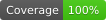

# GitHub Gravity




让你的 GitHub 贡献图在重力作用下掉落，与自定义文字碰撞，生成精美的 SVG 动画。

> [English](./README.md)

## 预览


## 在线预览

在浏览器里直接试用：调整参数、上传字体文件或填写字体 URL，然后播放查看效果。

<https://flycran.github.io/github-gravity/>

## 灵感来源

本项目灵感来自 [Orta Therox](https://github.com/Orta) 的创意。感谢 Orta 为开源社区做出的杰出贡献！

## 使用方法

```yaml
- name: Generate Gravity SVG
  uses: flycran/github-gravity@v1
  with:
    username: flycran
    text: GitHub Gravity
    output-path: gravity.svg
```

### 输入参数

| 参数 | 必填 | 默认值 | 说明 |
|---|---|---|---|
| `username` | ✅ | - | GitHub 用户名，用于获取贡献数据 |
| `text` | ❌ | `username` 的值 | 作为碰撞障碍物的文字 |
| `output-path` | ❌ | `gravity.svg` | SVG 输出路径 |
| `font-size` | ❌ | `80` | 碰撞文字大小 |
| `compression-tolerance` | ❌ | `0.5` | 轨迹压缩容差（SVG 像素）。播放时每个原始时刻的动画位置与真实位置的偏差不超过该值。默认值适合多数场景；`0` 为完全无损（位置与节奏都精确）（见下文） |
| `compression-algorithm` | ❌ | `Greedy` | 轨迹压缩算法：`Greedy`（快）、`DP`（体积最小）、`RDP`（最快），差异见下文 |
| `shape` | ❌ | `circle` | 贡献方块的形状（`circle` 或 `square`） |
| `text-top` | ❌ | `50` | 文字距离世界顶部的距离，控制文字垂直位置 |
| `background-color` | ❌ | `transparent` | SVG 背景颜色（CSS 颜色值） |
| `text-color` | ❌ | `black` | 碰撞文字颜色（CSS 颜色值） |
| `width` | ❌ | `300` | 物理世界宽度。⚠️ 会影响布局与 SVG 尺寸 |
| `height` | ❌ | `150` | 物理世界高度。⚠️ 会影响布局与 SVG 尺寸 |
| `size` | ❌ | `4` | 贡献方块边长。⚠️ 会影响物理表现 |
| `interval` | ❌ | `1.5` | 贡献方块间距。⚠️ 会影响物理表现 |
| `font-path` | ❌ | 内置字体 | 自定义字体文件（`.ttf`/`.otf`），相对仓库根目录，也可以直接给 `http(s)` 链接。⚠️ 部分字体可能无法正常加载 |

### 减小文件体积

轨迹默认开启压缩：`compression-tolerance`（默认 `0.5`）会把轨迹点合并为关键帧，保证播放时
每个原始时刻的插值位置与真实位置的偏差（SVG 像素）不超过阈值，并通过 `keyTimes` 保留每个
关键帧的原始时间——碰撞、落地、停顿等速度变化都会保留为关键帧，按真实节奏播放。

默认值肉眼不可见，体积已经能小几个数量级，多数场景保留默认即可。设为 `0` 得到无损轨迹——
只有匀速直线段和静止段会被压缩；调大（如 `1.5`）压缩更狠，但轨迹会明显走样。

### 选择压缩算法

三种算法保证相同的保真度，差异只在保留的关键帧数量和耗时。以下为 360 条真实轨迹
（每条约 1000 点）在默认容差 `0.5` 下的实测数据：

| 算法 | 平均关键帧 | 压缩率 | 耗时 | 特点 |
|---|---|---|---|---|
| `Greedy`（默认） | 32.1 | 30.7x | ~0.2s | 单遍贪心不回溯，结果距最优仅 1~3% |
| `DP` | 31.3 | 31.5x | ~2s | 全局最少关键帧 = 体积最小；耗时随轨迹长度超线性增长 |
| `RDP` | 37.1 | 26.6x | ~40ms | 最快，保留的关键帧最多 |

通常保持默认值即可。

### 高级自定义

`width`、`height`、`size`、`interval` 改动的是物理世界本身，而不只是输出尺寸。贡献方块按
`size` 和 `interval` 排布，文字以 `width` 居中，下落高度由 `height` 决定——请成套调整并核对
效果，不要只改其中一个。

`font-path` 用于替换碰撞字体，可以给本地 `.ttf`/`.otf` 路径，也可以直接给 `http(s)` 链接。
默认使用内置的 Liberation Serif Bold，因为它轮廓规整、能稳定三角化。自定义字体有风险：

- 未闭合或自相交的轮廓，大多数渲染器会静默忽略，但物理碰撞体使用的三角化算法会直接报错。
- 部分字体根本无法被 opentype.js 解析（例如很常见的 DejaVu 系列，会因 GSUB 表解析失败）。
- 字体度量不同，通常需要重新调整 `font-size` 和 `text-top`。

### 输出

| 输出 | 说明 |
|---|---|
| `svg-path` | 生成的 SVG 文件路径 |

### 完整示例

```yaml
name: Generate Contribution Gravity

on:
  workflow_dispatch:
  schedule:
    - cron: '0 0 * * *'
  push:
    branches:
      - main

jobs:
  gravity:
    runs-on: ubuntu-latest
    steps:
      - uses: actions/checkout@v6
      - uses: flycran/github-gravity@v1
        with:
          username: flycran
          text: GitHub Gravity
          output-path: deploy/gravity.svg
      - uses: peaceiris/actions-gh-pages@v4
        with:
          github_token: ${{ secrets.GITHUB_TOKEN }}
          publish_dir: ./deploy
          publish_branch: output
          keep_files: false
          force_orphan: true
```

## 开发

### 环境设置

```bash
bun install
```

### 测试

```bash
npm run test
```

### 打包

修改 `src/` 下的代码后，需要重新打包：

```bash
npm run bundle
```

Action 的打包产物不包含网页版，网页版用 `bun run build:web` 单独构建，静态资源输出到 `dist-web/`。

### 本地测试

```bash
npx @github/local-action . src/main.ts .env
```

## 发布新版本

查看 [Versioning](https://github.com/actions/toolkit/blob/main/docs/action-versioning.md) 了解 GitHub Actions 版本管理。

